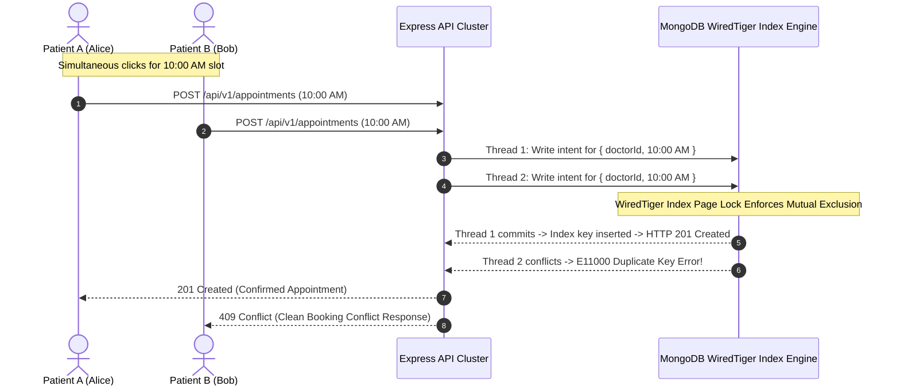

# CareQ — Enterprise Healthcare Platform & Concurrency Engine
### High-Performance Appointment Scheduling, Race Condition Prevention & Database Engineering

[](https://www.typescriptlang.org/)
[](https://nodejs.org/)
[](https://expressjs.com/)
[](https://www.mongodb.com/)
[](https://owasp.org/www-project-api-security/)
[](https://www.hhs.gov/hipaa/for-professionals/security/laws-regulations/index.html)

**CareQ** is a backend system designed for high-concurrency clinical appointment scheduling, database optimization, and healthcare data security. It demonstrates how to solve real-world distributed systems challenges: preventing double-booking race conditions under high concurrency, optimizing MongoDB query execution plans using the ESR rule, enforcing multi-layered authorization to prevent BOLA/IDOR, and maintaining tamper-resistant HIPAA audit trails.

---

## Architecture Overview

```mermaid
flowchart TD
    subgraph ClientLayer["Client & Consumers"]
        PatientApp["Patient Web / Mobile App"]
        DocPortal["Doctor Portal"]
        DeskKiosk["Receptionist / Admin Kiosk"]
    end

    subgraph SecurityGateway["API Gateway & Hardening Layer"]
        HelmetMW["Helmet Security Headers (CSP, HSTS)"]
        CorsMW["Strict CORS Whitelist"]
        RateLimitMW["Sliding Window Rate Limiter"]
        SanitizeMW["Express 5 Deep NoSQL Key Sanitizer"]
        AuthMW["JWT Bearer Authentication (15m Short-Lived)"]
        RBACMW["Role-Based Access Control (RBAC)"]
        OwnershipMW["BOLA / IDOR Resource Ownership Guard"]
        AuditMW["HIPAA § 164.312 Audit Logging Middleware"]
    end

    subgraph DomainEngine["Core Business Modules"]
        M1["1. Identity & Profile Service<br/>Decoupled User / Patient / Doctor, Refresh Token Rotation (RTR)"]
        M2["2. Doctor Availability & Scheduling Engine<br/>UTC Interval Math, Dynamic Slot Generator, Unique Partial Index Lock"]
        M3["3. Appointment Management Engine<br/>Finite State Machine (FSM), Atomic Reschedule, Keyset Cursor Pagination"]
        M4["4. Query Optimization Engine<br/>ESR Rule Compound Indexes, .lean() Deserialization, Covered Queries"]
        M5["5. Healthcare Security & ePHI Guard<br/>Tamper-Resistant Audit Trail, Synthetic Factory, Zero-PII Sandbox"]
    end

    subgraph StorageLayer["Data Layer: MongoDB WiredTiger Replica Set"]
        UserCol[("Users Collection<br/>email unique, password select:false")]
        PatientCol[("Patients Collection<br/>userId unique, embedded emergency contact")]
        DoctorCol[("Doctors Collection<br/>userId unique, department index")]
        AvailCol[("Availability Collection<br/>doctorId + dayOfWeek unique")]
        ApptCol[("Appointments Collection<br/>Unique Partial Compound Index Lock")]
        AuditCol[("AuditLogs Collection<br/>Append-Only Immutable Event Stream")]
    end

    ClientLayer --> SecurityGateway
    SecurityGateway --> DomainEngine
    DomainEngine --> StorageLayer
```



---

## 5 Interview Mastery Guides

Every module includes an exhaustive senior/staff-level interview preparation guide detailing architectural trade-offs, alternative designs, failure modes, and deep follow-up questions:

| Module | Core System Topics | Deep-Dive Interview Guide |
| :--- | :--- | :--- |
| **Module 1** | Decoupled Identity Architecture, Refresh Token Rotation (RTR), Token Replay Defense, BOLA/IDOR Mitigation | 📄 [INTERVIEW_MASTERY_MODULE_1.md](docs/INTERVIEW_MASTERY_MODULE_1.md) |
| **Module 2** | The TOCTOU Double-Booking Problem, Distributed Locks vs. Partial Indexes, Interval Math Proof, Idempotency | 📄 [INTERVIEW_MASTERY_MODULE_2.md](docs/INTERVIEW_MASTERY_MODULE_2.md) |
| **Module 3** | Finite State Machine (FSM), Atomic Slot Swapping in ACID Transactions, $O(1)$ Keyset Cursor vs. $O(N)$ Offset Pagination | 📄 [INTERVIEW_MASTERY_MODULE_3.md](docs/INTERVIEW_MASTERY_MODULE_3.md) |
| **Module 4** | Execution Plans (`.explain("executionStats")`), The ESR Rule, 33.55MB Sort Memory Limit, Mongoose `.lean()` Optimization | 📄 [INTERVIEW_MASTERY_MODULE_4.md](docs/INTERVIEW_MASTERY_MODULE_4.md) |
| **Module 5** | HIPAA § 164.312 Audit Logging, OWASP API Security Top 10 (2023), ReBAC for Doctors, NoSQL Operator Injection | 📄 [INTERVIEW_MASTERY_MODULE_5.md](docs/INTERVIEW_MASTERY_MODULE_5.md) |

---

## The Concurrency Challenge: Preventing Double Booking

### The Problem
When two patients attempt to book the exact same 10:00 AM doctor slot simultaneously, a naive check-then-write approach (`findOne` followed by `create`) creates a **Time-Of-Check to Time-Of-Use (TOCTOU)** race condition. Both concurrent requests see the slot as available and both execute inserts, resulting in catastrophic double-booking.



### The Solution: Unique Compound Partial Filter Index
```typescript
AppointmentSchema.index(
  { doctorId: 1, slotStartTime: 1 },
  {
    unique: true,
    partialFilterExpression: {
      status: {
        $in: [
          AppointmentStatus.REQUESTED,
          AppointmentStatus.CONFIRMED,
          AppointmentStatus.CHECKED_IN,
          AppointmentStatus.IN_PROGRESS,
        ],
      },
    },
  }
);
```

### Empirical Concurrency Benchmark Proof (`npm run test:concurrency`)
We executed an automated stress test firing **10 concurrent asynchronous requests** via `Promise.all()` targeting the **exact same 09:20 AM slot**:

```text
===============================================================
   FIRING 10 CONCURRENT BOOKING REQUESTS FOR: 2026-11-20T09:20:00.000Z
===============================================================

All 10 concurrent requests finished in 48ms.

Execution Results per Patient:
┌─────────┬──────────────┬────────┬─────────┬────────────────────┬────────────────────────────────────────────────────────┐
│ (index) │ patientName  │ status │ success │ code               │ message                                                │
├─────────┼──────────────┼────────┼─────────┼────────────────────┼────────────────────────────────────────────────────────┤
│ 0       │ 'Patient_1'  │ 201    │ true    │ undefined          │ 'Appointment booked successfully'                      │
│ 1       │ 'Patient_2'  │ 409    │ false   │ 'BOOKING_CONFLICT' │ 'Booking conflict: Slot just booked by another...'     │
│ 2       │ 'Patient_3'  │ 409    │ false   │ 'BOOKING_CONFLICT' │ 'Booking conflict: Slot just booked by another...'     │
│ ...     │ ...          │ ...    │ ...     │ ...                │ ...                                                    │
│ 9       │ 'Patient_10' │ 409    │ false   │ 'BOOKING_CONFLICT' │ 'Booking conflict: Slot just booked by another...'     │
└─────────┴──────────────┴────────┴─────────┴────────────────────┴────────────────────────────────────────────────────────┘

--- Concurrency Verification Summary ---
Total Requests:        10
Successful Bookings:   1 (Expected: 1)
Conflict Rejections:   9 (Expected: 9)
Actual MongoDB Docs:   1 (Expected: 1)

>>> SUCCESS: RACE CONDITION PREVENTED! DOUBLE BOOKING IS IMPOSSIBLE! <<<
```

---

## Database Performance & Optimization

### The ESR Rule (Equality, Sort, Range)
When designing compound indexes for queries involving filters, sorting, and ranges, fields must follow the **ESR Rule**:
$$\mathbf{E} \text{ (Equality)} \quad \longrightarrow \quad \mathbf{S} \text{ (Sort)} \quad \longrightarrow \quad \mathbf{R} \text{ (Range)}$$

In CareQ, doctor schedule lookups (`find({ doctorId, status, slotStartTime: { $gte, $lte } }).sort({ slotStartTime: 1 })`) use the compound index:
$$\{ \underbrace{\text{doctorId}: 1, \text{status}: 1}_{\mathbf{E} \text{ (Equality)}}, \quad \underbrace{\text{slotStartTime}: 1}_{\mathbf{S} \text{ / } \mathbf{R} \text{ (Sort & Range)}} \}$$

### Empirical Benchmark Across 20,000 Documents (`npm run test:explain`)

```text
===============================================================
                 PERFORMANCE BENCHMARK SUMMARY                 
===============================================================
┌─────────┬──────────────────────────────────┬──────────────┬───────────────┬───────────────┬──────────────────┐
│ (index) │ Configuration                    │ DB Time (ms) │ Docs Examined │ Keys Examined │ Efficiency Ratio │
├─────────┼──────────────────────────────────┼──────────────┼───────────────┼───────────────┼──────────────────┤
│ 0       │ '1. No Index (COLLSCAN)'         │ 21           │ 20,000        │ 0             │ '1000.0 : 1'     │
│ 1       │ '2. Suboptimal Range Index'      │ 5            │ 68            │ 84            │ '3.4 : 1'        │
│ 2       │ '3. ESR Compound Index (IXSCAN)' │ 10           │ 20            │ 20            │ '1.0 : 1'        │
└─────────┴──────────────────────────────────┴──────────────┴───────────────┴───────────────┴──────────────────┘
```

#### Application Layer Optimization (`.lean()` vs Mongoose Hydration):
```text
Hydrated Mongoose Documents Avg Latency: 2.35 ms
Lean Plain JS Objects (.lean()) Latency:  0.89 ms
Application CPU / Latency Reduction:     62.1% faster with .lean()!
```

---

## API Endpoints Reference

### Authentication & Identity (`/api/v1/auth`)
| Method | Endpoint | Access | Description |
| :--- | :--- | :--- | :--- |
| `POST` | `/register/patient` | Public | Atomic creation of `User` + `Patient` profile in transaction |
| `POST` | `/register/doctor` | Public | Atomic creation of `User` + `Doctor` profile |
| `POST` | `/login` | Public | Returns short-lived access token + rotating refresh token |
| `POST` | `/refresh` | Public | Consumes refresh token, issues new token pair (detects reuse) |
| `POST` | `/logout` | Authenticated | Revokes current session token |

### Doctor Scheduling (`/api/v1/doctors`)
| Method | Endpoint | Access | Description |
| :--- | :--- | :--- | :--- |
| `GET` | `/` | Public | List all doctors with specialization & department |
| `GET` | `/:doctorId/slots?date=YYYY-MM-DD` | Public | Dynamic slot generation (excludes breaks & holidays) |
| `POST` | `/:doctorId/availability` | Doctor / Admin | Configure weekly recurring working hours & breaks |
| `POST` | `/:doctorId/holidays` | Doctor / Admin | Schedule blackout dates & vacations |

### Appointment Management (`/api/v1/appointments`)
| Method | Endpoint | Access | Description |
| :--- | :--- | :--- | :--- |
| `POST` | `/` | Patient / Staff | Book appointment (concurrency-protected) |
| `GET` | `/?page=1&limit=10&cursor=...` | Authenticated | Keyset cursor or offset pagination (role-scoped) |
| `GET` | `/:id` | Owner / Staff | View appointment details |
| `PATCH` | `/:id/status` | Role Permitted | Validated Finite State Machine transition |
| `PATCH` | `/:id/reschedule` | Patient / Staff | Atomic slot swap in ACID transaction |
| `DELETE` | `/:id` | Patient / Staff | Regulatory cancellation (status update + slot release) |

### Patient Records (`/api/v1/patients`)
| Method | Endpoint | Access | Description |
| :--- | :--- | :--- | :--- |
| `GET` | `/me` | Patient | Zero-parameter self-service profile (IDOR-proof) |
| `GET` | `/:id` | Owner / Staff | Protected by `validatePatientOwnership` + HIPAA Audit |
| `GET` | `/` | Staff Only | Paginated patient directory with search |

---

## Automated Verification & Test Suites

CareQ uses an embedded in-memory MongoDB replica set (`mongodb-memory-server`) allowing all multi-document ACID transactions, unique index locks, and execution plan benchmarks to run with **zero external database dependencies**:

```bash
# 1. Run Identity, Session & IDOR Protection Suite
npx tsx scripts/test-module1.ts

# 2. Run High-Concurrency Double-Booking Stress Test (10 simultaneous requests)
npm run test:concurrency

# 3. Run Appointment Lifecycle & Finite State Machine Suite
npx tsx scripts/test-module3.ts

# 4. Run MongoDB Query Plan & Latency Optimization Benchmark (20,000 docs)
npm run test:explain

# 5. Run Healthcare Security, HIPAA Audit Trail & NoSQL Injection Suite
npx tsx scripts/test-module5.ts
```

---

## Quick Start (Local Development)

```bash
# 1. Clone repository
git clone https://github.com/MohitPant2803/CareQ--Healthcare-Platform.git
cd CareQ--Healthcare-Platform

# 2. Install dependencies
npm install

# 3. Configure environment variables
cp .env.example .env

# 4. Start development server with live reload
npm run dev
```

---

## Engineering Author
**Mohit Pant**  
*CareQ — Distributed Systems & Healthcare Backend Engineering*
