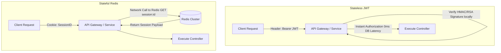
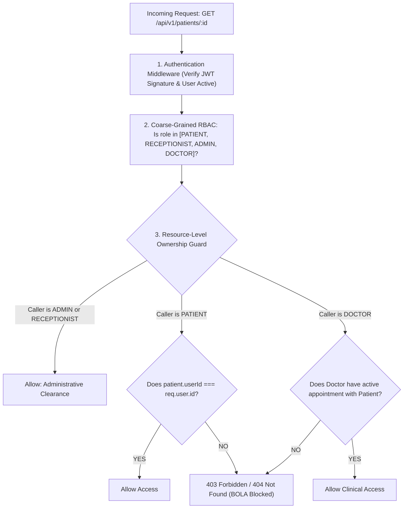

# CareQ Engineering Interview Mastery Guide
## Module 1: Patient, Doctor & Identity Management

> **Target Roles:** Senior Backend Engineer, Distributed Systems Engineer, Healthcare API Specialist  
> **Core Topics:** Database Modeling, MongoDB ACID Transactions, Authentication Lifecycle, Refresh Token Rotation, RBAC vs. BOLA/IDOR, Defense-in-Depth Security.

---

## Table of Contents
1. [Database Architecture & Schema Modeling](#1-database-architecture--schema-modeling)
   - Q1.1: Unified User vs. Decoupled Identity Model (Patient/Doctor)
   - Q1.2: References vs. Embedding Decisions & MongoDB 16MB Limit
   - Q1.3: Primary Key Strategy: ObjectId vs. UUIDv4 vs. ULID
2. [ACID Transactions & Data Integrity in NoSQL](#2-acid-transactions--data-integrity-in-nosql)
   - Q2.1: Multi-Document ACID Transactions vs. Sagas / 2-Phase Commits
   - Q2.2: The `WriteConflict (code 112: catalog changes)` Bug & WiredTiger Internals
   - Q2.3: Read/Write Concerns in Transactions (`snapshot` vs. `majority`)
3. [Authentication, Token Lifecycle & Session Management](#3-authentication-token-lifecycle--session-management)
   - Q3.1: Stateless JWT + Refresh Token vs. Stateful Redis Sessions
   - Q3.2: Refresh Token Rotation (RTR) & Automated Replay Attack Mitigation
   - Q3.3: Immediate Token Revocation & The `passwordChangedAt` Pattern
   - Q3.4: Password Hashing Algorithms: Bcrypt vs. Argon2id vs. PBKDF2
4. [Authorization, BOLA / IDOR & Healthcare Access Control](#4-authorization-bola--idor--healthcare-access-control)
   - Q4.1: The Primary Healthcare Security Question: Preventing Cross-Patient Record Access
   - Q4.2: HTTP 403 Forbidden vs. HTTP 404 Not Found (ID Enumeration Defenses)
   - Q4.3: Relationship-Based Access Control (ReBAC) for Doctor-Patient Encounters
5. [API Security, Input Validation & Defensive Engineering](#5-api-security-input-validation--defensive-engineering)
   - Q5.1: NoSQL Injection Mechanisms in Mongoose & Express 5 Query Getter Quirks
   - Q5.2: Mass Assignment Attacks & Strict Runtime Parsing with Zod
   - Q5.3: Distributed Rate Limiting: In-Memory vs. Redis Sliding Window

---

## 1. Database Architecture & Schema Modeling

### Q1.1: Why did you decouple the `User` identity model from the `Patient` and `Doctor` domain models instead of using a single unified `User` collection with optional fields or Single Table Inheritance?

#### What the Interviewer is Evaluating:
Your understanding of domain-driven design (DDD), database normalization vs. denormalization, indexing overhead, memory working set size, and separation of security concerns.

#### The Ideal Answer:
In CareQ, we separated identity credentials (`User`) from clinical/domain profiles (`Patient`, `Doctor`) via 1-to-1 references (`userId`).

We chose this over a single unified collection for four reasons:

1. **Separation of Concerns & Privilege Separation:** The `User` model handles authentication mechanics: password hashes, active session tokens, MFA secrets, and password reset timestamps. Domain logic (clinical notes, emergency contacts, medical licensing numbers) belongs to business subdomains. Separating them ensures auth services never load or leak clinical data.
2. **Sparse Index & Field Bloat:** In a single collection, a doctor document would have dozens of null fields (`allergies`, `bloodGroup`, `emergencyContact`), while a patient document would have unused doctor fields (`licenseNumber`, `consultationFee`, `department`). While MongoDB handles sparse schemas well, sparse compound indexes consume memory and create indexing clutter.
3. **Working Set Memory Optimization:** MongoDB WiredTiger caches documents in memory. Authentication requests (login, token refresh) are high-frequency, low-payload operations. Caching lean `User` documents in RAM without clinical history reduces memory thrashing and keeps the database working set compact.
4. **Different Lifecycle and Access Patterns:** Patient records are subject to strict regulatory retention (e.g., HIPAA 6-7 year archiving), while inactive user credentials or session tokens can be pruned or rotated independently.

#### Alternatives Considered:
- **Alternative A: Single Collection with Discriminators (Single Table Inheritance).**
  - *Pros:* Zero `$lookup` / `.populate()` needed; all user data retrieved in one document read.
  - *Cons:* Pollutes the security boundary. Querying a user inadvertently loads sensitive medical notes unless strictly projected out. Schema validation becomes convoluted with conditional rules (e.g., "if role is DOCTOR, require licenseNumber").
- **Alternative B: Relational PostgreSQL with Foreign Keys.**
  - *Pros:* Native relational constraints (`ON DELETE CASCADE`), strict typing, ACID by default.
  - *Cons:* Less flexibility for semi-structured nested clinical data (e.g., dynamic allergy lists, varying emergency contacts, variable insurance schemas) without relying heavily on `JSONB`.

#### Follow-up 1: What is the performance cost of referencing in MongoDB? Isn't `.populate()` or `$lookup` an anti-pattern?
> **Answer:** In MongoDB, `.populate()` in Mongoose executes **two separate queries** under the hood: `User.findById()` followed by `Patient.find({ userId: { $in: [...] } })`. It is NOT an in-engine join. In high-throughput read paths, this introduces an extra network round-trip.
>
> If aggregation with `$lookup` is used, it performs an internal index scan on the target collection, which is fast **only if the foreign key (`userId`) is indexed**. In CareQ, `userId` has an explicit `{ unique: true, index: true }` constraint on both `Patient` and `Doctor`. Furthermore, for read-heavy operations, we avoid joins by having the client provide necessary tokens and querying only the collection needed for that specific workflow.

---

### Q1.2: Why did you embed `emergencyContact` and `address` within `Patient`, but referenced `userId`? When does embedding become an anti-pattern in MongoDB?

#### What the Interviewer is Evaluating:
Knowledge of the 1-to-1 vs. 1-to-N embedding rules, document size boundaries, and data volatility.

#### The Ideal Answer:
We followed the core MongoDB schema design heuristic: **"Data that is accessed together and changes together should be stored together."**

- **Why Embed `Address` and `EmergencyContact`:**
  1. **Strict 1-to-1 or bounded 1-to-Few relationship:** A patient typically has 1 primary address and 1-2 emergency contacts.
  2. **Atomic Reads and Writes:** When a receptionist opens a patient profile or an emergency room doctor views vital data, the address and emergency contact are needed immediately. Embedding guarantees a **single disk read** (zero joins).
  3. **No Independent Existence:** An emergency contact has no lifecycle outside the context of the patient. If the patient record is deleted or archived, the emergency contact has no standalone business value.

#### When Embedding Becomes an Anti-Pattern:
1. **Unbounded Growth (The 16MB BSON Limit):** If an embedded array can grow indefinitely (e.g., embedding every historical medical log, appointment, or telemetry sensor reading inside the patient document), the document will eventually hit MongoDB's hard 16MB document size limit.
2. **High Document Relocation Overhead:** When an embedded array grows frequently, WiredTiger must allocate larger chunks of disk space and relocate the document on disk, causing heavy fragmentation and disk write amplification.
3. **High Write Contention on Shared Data:** If multiple independent processes write to different nested subdocuments simultaneously, document-level locking in WiredTiger can cause write conflicts.

#### Follow-up 2: What is the "Bucket Pattern" or "Subset Pattern" in MongoDB, and when would you use it in CareQ?
> **Answer:** If a patient has 10,000 historical vitals readings (blood pressure, heart rate):
> - *Anti-pattern:* Embed all 10,000 in one patient document (hits 16MB limit) or create 10,000 separate individual documents (indexing overhead and slow queries).
> - *Solution (The Bucket Pattern):* Group vitals into monthly or daily documents:
>   `{ patientId, month: "2026-11", count: 120, readings: [ ... ] }`. This caps document size, optimizes index usage, and provides fast range queries for charts.

---

### Q1.3: What primary key strategy did you use (ObjectId)? How does it compare to UUIDv4 and ULID in distributed healthcare systems?

#### The Ideal Answer:
CareQ uses MongoDB's native 12-byte `ObjectId`. Here is the deep engineering comparison:

| Metric | MongoDB `ObjectId` (12 bytes) | `UUIDv4` (16 bytes / 36 chars) | `ULID` (16 bytes / 26 chars) |
| :--- | :--- | :--- | :--- |
| **Ordering** | **K-sortable** (starts with 4-byte Unix timestamp) | **Completely Random** | **Monotonically Sortable** (48-bit timestamp + 80-bit randomness) |
| **B-Tree Index Locality** | **High:** Appends mostly to the right edge of the index tree. | **Terrible:** Random insertion causes continuous B-Tree page splits and cache evictions. | **High:** Sequential insertion preserves cache locality. |
| **URL Friendliness** | Hex string (24 chars) | Hex with hyphens (36 chars) | Crockford's Base32 (URL-safe, no hyphens, human readable) |
| **Information Leakage** | **Leaks timestamp** and machine/PID metadata. | None. | **Leaks timestamp** (millisecond precision). |

#### Why ObjectId in CareQ:
For native MongoDB collections, `ObjectId` offers the smallest index footprint (12 bytes binary vs 16 bytes UUID or 36 bytes string) and maintains B-Tree cache locality. However, because `ObjectId` leaks the exact second of document creation, we never rely on it as a secure unpredictable token.

---

## 2. ACID Transactions & Data Integrity in NoSQL

### Q2.1: MongoDB is non-relational. Why did you use multi-document ACID transactions for patient/doctor registration, and what are the alternatives?

#### The Ideal Answer:
Registration in CareQ requires synchronizing two collections: creating a `User` (for auth credentials) and a `Patient` (for clinical details).

If `User.save()` succeeds but `Patient.save()` fails (due to validation error, network blip, or duplicate constraints), the database enters an inconsistent state: an orphaned user credentials record exists without a matching profile. The user cannot log in cleanly, and their email is locked from re-registration.

By wrapping both in a Mongoose ClientSession transaction (`session.startTransaction()` and `session.commitTransaction()`), MongoDB provides **Atomicity and Isolation**: both documents persist together, or neither does.

#### Alternatives Evaluated:
1. **Compensating Actions (Saga / Manual Rollback):**
   ```typescript
   try {
     const user = await User.create(...);
     const patient = await Patient.create({ userId: user._id, ... });
   } catch (err) {
     if (user) await User.deleteOne({ _id: user._id }); // Manual rollback
     throw err;
   }
   ```
   - *Why rejected:* If the Node.js server crashes or loses power between the user creation and the `deleteOne()` call, the orphan record remains forever. It is not crash-safe.
2. **Two-Phase Commit (2PC):**
   - *Why rejected:* Complex, requires state machines in the database, high latency, obsolete since MongoDB 4.0 added multi-document ACID transactions.
3. **Single Embedded Document (Pre-Registration):**
   - *Why rejected:* Breaks separation of concerns and privilege boundaries between auth credentials and clinical data.

---

### Q2.2: During our test run, we encountered `MongoServerError: WriteConflict (code 112: catalog changes)`. Why did this happen in WiredTiger, and how did you resolve it?

#### What the Interviewer is Evaluating:
Deep understanding of database engine internals, DDL vs. DML locks, and transaction boundary rules. This is a question 95% of junior/mid-level candidates fail.

#### The Ideal Answer:
In MongoDB WiredTiger:
1. **DML (Data Manipulation Language):** Operations like `insertOne`, `updateOne`, and `deleteOne` operate inside transactions with optimistic concurrency control.
2. **DDL (Data Definition Language):** Operations like `createCollection` and `createIndex` modify the **database catalog metadata**.

When a MongoDB transaction executes an insert into a collection that **does not exist yet**, MongoDB attempts an *implicit collection creation*. Modifying the catalog requires an exclusive database metadata lock. **MongoDB transactions prohibit metadata/catalog locks inside an active transaction.**

Furthermore, when Mongoose connects, its `autoIndex` feature runs `createIndexes` in the background. If index creation runs concurrently with an active transaction on that same collection, WiredTiger detects a catalog change conflict and immediately aborts the transaction with `WriteConflict (code 112: catalog changes)`.

#### The Fix:
We implemented pre-boot schema initialization in `src/config/db.ts`:
```typescript
// Explicitly initialize collections and build indexes BEFORE taking live traffic
await Promise.all([
  User.createCollection(),
  Patient.createCollection(),
  Doctor.createCollection(),
]);
await Promise.all([
  User.init(),
  Patient.init(),
  Doctor.init(),
]);
```
This guarantees that all collections and B-Tree indexes exist before any transaction starts, eliminating catalog write conflicts completely.

---

### Q2.3: What are the performance costs of MongoDB multi-document transactions? Why wouldn't you wrap every API endpoint in a transaction?

#### The Ideal Answer:
1. **WiredTiger Cache Pressure:** Transactions hold uncommitted write versions in the WiredTiger cache. Long-running transactions prevent the cache from evicting dirty pages, increasing RAM usage.
2. **Optimistic Concurrency & Abort Rate:** MongoDB uses optimistic concurrency control. If two concurrent transactions modify the same document, one will fail with a `WriteConflict` and must be retried from the client application.
3. **Locking & Latency:** Multi-document transactions require global snapshots and synchronization across replica set secondaries during commit, adding latency (typically 5–20ms overhead).
4. **Conclusion:** Use transactions strictly for multi-document operations where data integrity cannot be maintained through single-document atomic updates (`$set`, `$inc`, `$push`).

---

## 3. Authentication, Token Lifecycle & Session Management

### Q3.1: Why did you use short-lived JWTs (15 min) + Refresh Tokens (7 days) instead of server-side sessions stored in Redis?

#### The Ideal Answer:
This is the classic **Stateless vs. Stateful Authentication** architecture trade-off.



| Dimension | JWT + Rotating Refresh Token (CareQ Choice) | Stateful Redis Session |
| :--- | :--- | :--- |
| **Read Latency** | **Sub-millisecond (CPU only):** Validated in memory via cryptographic signature (`jwt.verify`). Zero database or network lookups. | **Network bound:** 1–3ms per request to query Redis over TCP. |
| **Scalability** | Horizontally scalable across multi-region microservices without sharing a central session cache. | Requires Redis replication, sentinel failover, and memory capacity planning. |
| **Revocation Speed** | Eventual consistency: Revocation takes up to 15 minutes unless an active blacklist or `passwordChangedAt` check is performed. | **Instantaneous:** Deleting the key in Redis immediately revokes access. |
| **Payload Size** | Larger (~300-500 bytes per HTTP header). | Small session ID cookie (~32 bytes). |

#### Why CareQ Chose JWT + Refresh Token:
High-frequency healthcare requests (browsing schedules, checking slot availability, polling status) do not burden our database with session lookups. We combine the performance of stateless JWT access tokens with the control of stateful refresh tokens stored in MongoDB for session rotation and auditability.

---

### Q3.2: Walk me through Refresh Token Rotation (RTR). How does your code detect and mitigate a token replay/theft attack?

#### The Ideal Answer:
If an attacker steals a long-lived refresh token (e.g., via XSS or network sniffing), they could theoretically maintain persistence forever. **Refresh Token Rotation (RTR)** mitigates this:

1. **One-Time Use:** When a client sends a refresh token to `/api/v1/auth/refresh`, that token is immediately deleted and replaced with a newly generated token pair.
2. **Storage of Token Hashes:** In `User.refreshTokens`, we store the **SHA-256 hash** of active refresh tokens (never plaintext).
3. **Detection of Token Reuse (The Replay Attack):**
   - Suppose the legitimate user has Token $R_1$.
   - An attacker steals Token $R_1$.
   - The legitimate user refreshes with $R_1$. The server consumes $R_1$ and issues $R_2$ to the user.
   - Later, the attacker attempts to refresh with the stolen $R_1$.
   - The server queries `User.refreshTokens` for $\text{SHA256}(R_1)$.
   - It finds that $R_1$ is **NOT** in the list of active tokens!
   - **Mitigation Action:** The server identifies that a previously invalidated token has been replayed. This indicates a token compromise.
   - The server **wipes ALL active refresh tokens for that user (`user.refreshTokens = []`)**, terminating all active sessions across all devices immediately.

```typescript
// From src/services/auth.service.ts
const tokenIndex = user.refreshTokens.indexOf(hashed);
if (tokenIndex === -1) {
  // REUSE DETECTED!
  user.refreshTokens = [];
  await user.save();
  throw new Error('Detected compromised refresh token. All active sessions revoked.');
}
```

---

### Q3.3: If JWT access tokens are stateless, how do you revoke a user's access immediately if their password is changed or account is disabled?

#### The Ideal Answer:
We implemented the **Timestamp Invalidation Pattern (`passwordChangedAt`)**:

1. In `UserSchema`, we store `passwordChangedAt: Date`.
2. Whenever a user modifies their password, a Mongoose pre-save hook updates `passwordChangedAt = new Date(Date.now() - 1000)`.
3. In the JWT payload, the issuance timestamp is recorded as `iat` (issued at in epoch seconds).
4. In our `authenticate` middleware:
   ```typescript
   if (user.passwordChangedAt) {
     const changedTimestamp = Math.floor(user.passwordChangedAt.getTime() / 1000);
     if (decoded.iat < changedTimestamp) {
       return res.status(401).json({ message: 'Password recently changed. Please login again.' });
     }
   }
   ```
5. If the token was issued *before* the password was modified, it is immediately rejected, even if the cryptographic signature is mathematically valid.

---

### Q3.4: Why Bcrypt vs. Argon2id vs. PBKDF2? Why did you pick a work factor of 12?

#### The Ideal Answer:
- **Bcrypt:** An adaptive hashing algorithm based on the Blowfish cipher. It is specifically designed to be compute-intensive (CPU-bound) and incorporates a salt directly into the output string to prevent rainbow table attacks.
- **Argon2id (Winner of the Password Hashing Competition):** Memory-hard algorithm resistant to GPU and ASIC cracking attacks. In production enterprise healthcare systems, Argon2id is the gold standard recommended by OWASP.
- **Bcrypt in CareQ:** We chose `bcryptjs` for zero-dependency native Node.js portability.
- **Why Salt Rounds = 12?**
  - Salt rounds in Bcrypt represent $2^{\text{rounds}}$ iterations.
  - Round 10 $\rightarrow$ $\sim 80\text{ms}$ calculation time.
  - Round 12 $\rightarrow$ $\sim 250\text{–}300\text{ms}$ calculation time.
  - This strikes the sweet spot: slow enough that an attacker testing 1 billion leaked hashes on an RTX 4090 GPU would take decades, but fast enough not to block the Node.js event loop during legitimate user login.

---

## 4. Authorization, BOLA / IDOR & Healthcare Access Control

### Q4.1: The Core Interview Question: "How would you ensure that a patient cannot access another patient's medical information by simply changing the patient ID in an API request?"

#### What the Interviewer is Evaluating:
Your comprehension of **BOLA (Broken Object Level Authorization) / IDOR (Insecure Direct Object Reference)**, ranked **#1 in OWASP API Security Top 10**.

#### The Junior Answer (The Trap):
*"I check if the user is authenticated with a valid JWT and has the `PATIENT` role using an RBAC middleware like `authorize('PATIENT')`."*

#### Why That Answer Fails:
If Patient Alice has a valid token and role `PATIENT`, and she calls `GET /api/v1/patients/bob_patient_id`, the RBAC check passes because Alice *is* a patient! Coarse-grained RBAC checks **who you are (role)**, not **what resource you own (object-level authorization)**.

#### The Senior Engineer's Multi-Layered Defense:



1. **Self-Service Zero-Parameter Endpoints (`/me` Pattern):**
   For patient-facing mobile apps or web portals, do not expose `/patients/:patientId`. Expose `/api/v1/patients/me`. The backend extracts `req.user.id` strictly from the cryptographically verified JWT. There is no client-controlled ID parameter to tamper with.
2. **Resource-Level Ownership Middleware (`validatePatientOwnership`):**
   When parameterized endpoints are required (e.g., `/api/v1/patients/:id` for hospital staff), an ownership guard checks:
   - If caller is `ADMIN` or `RECEPTIONIST`: allow.
   - If caller is `PATIENT`: fetch the document and assert `patient.userId.toString() === req.user.id`.
3. **Database-Level Query Scoping (Defense-in-Depth):**
   Never execute `Patient.findById(req.params.id)`. Always scope the query:
   ```typescript
   const patient = await Patient.findOne({
     _id: req.params.id,
     userId: req.user.id // Enforces boundary at the database index level
   });
   ```

---

### Q4.2: Should an unauthorized IDOR request return HTTP 403 Forbidden or HTTP 404 Not Found?

#### The Ideal Answer:
**Return HTTP 404 Not Found.**

#### Rationale:
- If an attacker sends `GET /api/v1/patients/65f1234a` and gets `403 Forbidden`, the attacker learns that:
  1. The ID `65f1234a` **exists** in your database.
  2. It belongs to another patient.
  This allows the attacker to execute **ID Enumeration Attacks** (scraping your ID space to discover how many patients you have and map their IDs).
- Returning `404 Not Found` reveals nothing: the attacker cannot distinguish between a non-existent record and an unauthorized record.
- *Exception:* In internal audits or admin tooling, `403 Forbidden` is preferred for explicit debugging and logging.

---

### Q4.3: How does this access control model expand when a Doctor needs to view a Patient's record?

#### The Ideal Answer:
This requires **ReBAC (Relationship-Based Access Control)**.

A doctor does not have blanket permission to view all patients in a hospital (which would violate HIPAA's "Minimum Necessary Rule"). A doctor may only view a patient's records if an active **care relationship** exists:

```typescript
// ReBAC verification for Doctor access
const hasAppointment = await Appointment.exists({
  doctorId: req.user.doctorId,
  patientId: requestedPatientId,
  status: { $in: ['CONFIRMED', 'CHECKED_IN', 'IN_PROGRESS', 'COMPLETED'] }
});

if (!hasAppointment) {
  return res.status(403).json({ message: 'No active clinical relationship with this patient.' });
}
```

---

## 5. API Security, Input Validation & Defensive Engineering

### Q5.1: How does NoSQL injection occur in MongoDB/Express, and why did `express-mongo-sanitize` fail in Express 5?

#### The Ideal Answer:

#### How NoSQL Injection Works:
Suppose you have a login endpoint:
```typescript
const user = await User.findOne({ email: req.body.email, password: req.body.password });
```
If an attacker sends JSON:
```json
{
  "email": { "$ne": null },
  "password": { "$ne": null }
}
```
MongoDB interprets `$ne: null` as an operator: *"Find any document where email is not null and password is not null."* The attacker logs in as the first user in the database without knowing their email or password!

#### Why `express-mongo-sanitize` Broke in Express 5:
`express-mongo-sanitize` works by reassigning `req.query = sanitize(req.query)`.
In **Express 5**, the HTTP `IncomingMessage` object defines `query` as a **getter-only property** for security and immutability. Trying to assign `req.query = ...` throws:
`TypeError: Cannot set property query of #<IncomingMessage> which has only a getter`.

#### Our Solution in CareQ:
We built an in-place deep object sanitizer that mutates the keys of the object rather than reassigning the property reference, stripping any key starting with `$` or containing `.`:
```typescript
const sanitize = (obj: any): any => {
  if (!obj || typeof obj !== 'object') return obj;
  for (const key of Object.keys(obj)) {
    if (key.startsWith('$') || key.includes('.')) {
      delete obj[key];
    } else if (typeof obj[key] === 'object') {
      sanitize(obj[key]);
    }
  }
  return obj;
};
```

---

### Q5.2: What is a Mass Assignment vulnerability, and how does your Zod schema defend against it?

#### The Ideal Answer:
**Mass Assignment (OWASP API6:2023):** When an API endpoint blindly passes `req.body` directly into a database update or creation method:
```typescript
// VULNERABLE
const user = await User.create(req.body);
```
If a malicious user submits:
```json
{
  "email": "hacker@test.com",
  "password": "Password123!",
  "role": "ADMIN",
  "isActive": true
}
```
The database sets `role: "ADMIN"`, granting the user administrative privileges.

#### The Defense:
In CareQ, all inputs pass through strict **Zod validation schemas**. Any unexpected property is stripped or rejected before the controller ever sees it:
```typescript
export const registerPatientSchema = z.object({
  email: z.string().email(),
  password: z.string().min(8),
  firstName: z.string(),
  lastName: z.string(),
  // Notice: 'role' is intentionally NOT defined in the schema!
});
```
In the controller, the role is explicitly hardcoded: `role: UserRole.PATIENT`.

---

### Q5.3: What rate limiting strategy did you configure, and how does it change when moving from single-instance to Kubernetes?

#### The Ideal Answer:
In `src/app.ts`, we applied `express-rate-limit` to `/api/v1/auth` to prevent credential stuffing and brute-force attacks (max 100 requests per 15 minutes per IP).

#### Scaling to Distributed / Kubernetes Environments:
- **In-Memory Store (Default):** Keeps hit counters in local Node.js process RAM. If you deploy 5 pods behind a Load Balancer, an attacker's requests are distributed round-robin across pods, effectively multiplying the allowed threshold by 5x.
- **Production Solution:** Use `rate-limit-redis`. Hit counters are stored in a centralized Redis cluster using a **Sliding Window Log** or **Token Bucket** algorithm. Regardless of which pod receives the request, the rate limiter checks the shared Redis key `ratelimit:<ip>`, enforcing global rate limits.

---

## Summary Checklist: Module 1 Senior Interview Talking Points

When summarizing your work on Module 1 to an engineering manager or staff engineer, emphasize these 5 pillars:

1. **Decoupled Identity Architecture:** Separated `User` from `Patient`/`Doctor` to isolate auth credentials from clinical data and optimize memory working sets.
2. **ACID Transaction Resilience:** Atomic creation of user and profile records with pre-initialized collections to eliminate WiredTiger catalog lock conflicts.
3. **Session & Token Hygiene:** 15-minute access tokens with Refresh Token Rotation, token reuse detection, and cryptographic password invalidation.
4. **BOLA/IDOR Defense-in-Depth:** Zero-parameter `/me` endpoints, resource-level ownership middleware, and database-level query scoping.
5. **Hardened API Gateway:** Express 5 compatible NoSQL sanitization, strict Zod schema parsing to stop Mass Assignment, and rate limiting.
