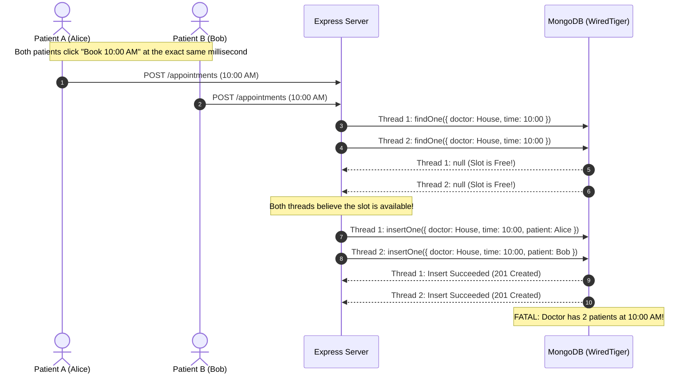
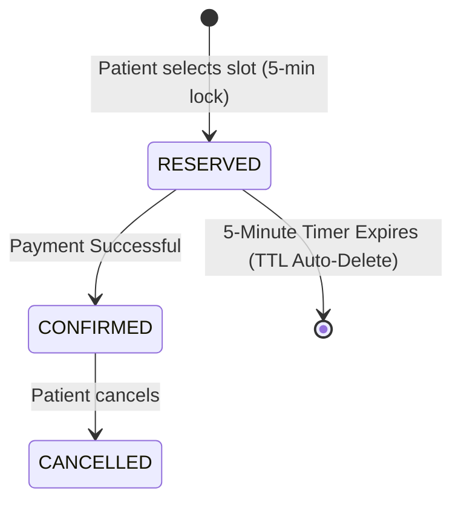

# CareQ Engineering Interview Mastery Guide
## Module 2: Doctor Availability & Scheduling Engine

> **Target Roles:** Staff/Senior Backend Engineer, Distributed Systems Engineer, Database Architect  
> **Core Topics:** High-Concurrency Booking, Race Condition Prevention, TOCTOU Vulnerabilities, Unique Partial Indexes, Dynamic Slot Generation, Date/Timezone Modeling, Idempotency.

---

## Table of Contents
1. [The Double-Booking Problem & Concurrency Mechanisms](#1-the-double-booking-problem--concurrency-mechanisms)
   - Q1.1: The TOCTOU (Time-Of-Check to Time-Of-Use) Race Condition Breakdown
   - Q1.2: Comparative Analysis of 4 Concurrency Control Strategies:
     - Strategy A: MongoDB Unique Compound Partial Index (CareQ Choice)
     - Strategy B: Distributed Locks via Redis (Redlock)
     - Strategy C: Optimistic Concurrency Control (OCC / Version CAS)
     - Strategy D: Relational Pessimistic Locking (`SELECT FOR UPDATE`)
   - Q1.3: Partial Filter Expressions in Unique Indexes: Freeing Cancelled Slots
   - Q1.4: Temporary Slot Reservations (5-Minute Cart Holds & TTL Indexes)
2. [Date, Time & Timezone Modeling in Healthcare](#2-date-time--timezone-modeling-in-healthcare)
   - Q2.1: UTC ISO-8601 vs. Wall-Clock Local Time vs. IANA Timezones
   - Q2.2: Daylight Saving Time (DST) Transitions: Preventing 1-Hour Schedule Shifts
   - Q2.3: The Mathematical Proof of Time Interval Overlap Detection
3. [Slot Generation Engine Architecture](#3-slot-generation-engine-architecture)
   - Q3.1: Dynamic On-The-Fly Generation vs. Pre-Generated Slot Documents
   - Q3.2: Break Intervals & Holiday Exclusion Algorithm ($O(1)$ Hash Set Matching)
   - Q3.3: High-Throughput Read Caching: Redis Invalidation Strategies
4. [Idempotency & Network Resilience](#4-idempotency--network-resilience)
   - Q4.1: Network Partition During Booking: The Idempotency Key Pattern
   - Q4.2: Handling Transient Database Retries under High Write Contention

---

## 1. The Double-Booking Problem & Concurrency Mechanisms

### Q1.1: Walk me through the exact failure mode of a naive appointment booking implementation under high concurrency. Why does checking availability before writing fail?

#### The Ideal Answer:
The naive implementation consists of two sequential steps:
```typescript
// VULNERABLE TO TOCTOU RACE CONDITIONS
async function naiveBook(doctorId, slotStartTime, patientId) {
  // Step 1: Check availability
  const existing = await Appointment.findOne({ doctorId, slotStartTime, status: 'CONFIRMED' });
  if (existing) {
    throw new Error('Slot already booked');
  }

  // Step 2: Book slot
  return await Appointment.create({ doctorId, slotStartTime, patientId, status: 'CONFIRMED' });
}
```

This suffers from a classic **TOCTOU (Time-Of-Check to Time-Of-Use)** concurrency bug. 



#### Why it Happens:
The read (Check) and the write (Use) are **two separate, non-atomic database operations**. Between the instant Thread 1 reads `null` and the instant Thread 1 commits its write, Thread 2 executes its read. Both threads see the slot as available and both execute inserts.

Application-level checks cannot prevent race conditions because HTTP requests run concurrently across asynchronous Node.js event loops, multiple process clusters, or load-balanced containers.

---

### Q1.2: Compare the 4 major concurrency control strategies for booking systems. Why did CareQ choose the Unique Compound Partial Index?

#### Architectural Tradeoff Matrix:

| Strategy | Implementation | Pros | Cons / Failure Modes |
| :--- | :--- | :--- | :--- |
| **Strategy A: Unique Compound Index (CareQ Choice)** | `db.appointments.createIndex({ doctorId: 1, slotStartTime: 1 }, { unique: true, partialFilterExpression: ... })` | **Zero external dependencies.** Enforced at the lowest database engine layer (WiredTiger B-Tree page lock). Impossible to bypass even across multiple app instances or direct DB scripts. Maximum performance. | Requires database support for unique indexes and application-level handling of duplicate key error codes (`E11000`). |
| **Strategy B: Distributed Lock (Redis Redlock)** | Acquire lock `SET lock:doctor:slot <UUID> NX PX 5000` before query; release after insert. | Prevents the second request from even reading the DB until the first completes. Familiar pattern in microservices. | **Single Point of Failure (or Redis cluster overhead).** Network latency to Redis. Risk of lock expiration before DB write finishes (split-brain). Fails if Redis crashes or partition occurs. |
| **Strategy C: Optimistic Concurrency (OCC / Version CAS)** | Pre-allocated `Slot` documents with `version: N`. Execute `updateOne({ _id, isBooked: false, version: 1 }, { $set: { isBooked: true, version: 2 } })`. | Atomic single-document write. Native to MongoDB without multi-document overhead. | Requires generating millions of slot documents months in advance. High storage overhead and complex synchronization if doctor changes working hours. |
| **Strategy D: Relational Pessimistic Lock (`SELECT FOR UPDATE`)** | `SELECT * FROM slots WHERE id = 10 FOR UPDATE;` in PostgreSQL. | Blocks concurrent transactions at row level. Guaranteed consistency. | Heavy lock contention, potential deadlocks, degrades throughput, ties database threads to client latency. |

#### Why Strategy A (Unique Compound Index) is the Gold Standard for CareQ:
1. **Engine-Level Atomicity:** MongoDB B-Tree index pages require exclusive latches during insertion. When two requests attempt to insert `{ doctorId, slotStartTime }` simultaneously, the first write commits and inserts the index key. The second write immediately triggers an `E11000 duplicate key error`.
2. **Horizontal Scalability:** Whether you run 1 Express server or 100 Kubernetes pods behind an AWS ALB, the database remains the single source of truth without needing a synchronized Redis distributed lock coordinator.
3. **Application Layer Cleanliness:**
   ```typescript
   try {
     await appointment.save();
   } catch (err: any) {
     if (err.code === 11000) {
       // Graceful conflict response
       return res.status(409).json({ code: 'BOOKING_CONFLICT', message: 'Slot already booked.' });
     }
     throw err;
   }
   ```

---

### Q1.3: What is a MongoDB Partial Filter Expression, and how does it solve the "Cancelled Appointment" index trap?

#### What the Interviewer is Evaluating:
Index design expertise. Most developers create a simple unique index `{ doctorId: 1, slotStartTime: 1 }` and accidentally break appointment cancellations!

#### The Trap with Standard Unique Indexes:
If you create a standard unique index:
`db.appointments.createIndex({ doctorId: 1, slotStartTime: 1 }, { unique: true })`
1. Patient Alice books 10:00 AM $\rightarrow$ Document `{ doctorId, slotStartTime: 10:00, status: 'CONFIRMED' }` is saved.
2. Alice cancels her appointment $\rightarrow$ Document is updated to `{ status: 'CANCELLED' }`. We do NOT delete it because healthcare regulations require audit trails!
3. Patient Bob tries to book 10:00 AM $\rightarrow$ MongoDB attempts to insert Bob's appointment.
4. **FAILURE:** MongoDB throws `E11000 duplicate key error` because the key `{ doctorId, 10:00 }` already exists on Alice's cancelled record! Bob cannot book the freed slot!

#### The Senior Solution: Partial Filter Expression
```typescript
AppointmentSchema.index(
  { doctorId: 1, slotStartTime: 1 },
  {
    unique: true,
    partialFilterExpression: {
      status: {
        $in: [
          AppointmentStatus.REQUESTED,
          AppointmentStatus.CONFIRMED,
          AppointmentStatus.CHECKED_IN,
          AppointmentStatus.IN_PROGRESS,
        ],
      },
    },
  }
);
```

#### How it Works:
- Documents with status `CONFIRMED`, `REQUESTED`, `CHECKED_IN`, or `IN_PROGRESS` are indexed by the unique index. Uniqueness is strictly enforced among active appointments.
- The moment an appointment status changes to `CANCELLED` or `NO_SHOW`, MongoDB's index engine **removes the document from the unique index B-Tree**!
- The historical cancelled document remains safely stored in the collection for clinical audit, but the slot is **instantly available for another patient to book** without collision.

---

### Q1.4: How would you implement a "5-Minute Cart Hold" (Soft Reservation) so a patient can enter payment details without losing their slot?

#### The Ideal Answer:
We use a **Two-Phase Reservation Pattern**:



1. **Phase 1: Reserve (Soft Lock):**
   When the patient clicks a slot, create an appointment with `status: "RESERVED"` and `expiresAt: new Date(Date.now() + 5 * 60 * 1000)`.
   Because `RESERVED` is included in our unique index partial filter, no other patient can reserve or book this slot.
2. **Phase 2: Confirmation / Auto-Release:**
   - **Happy Path:** The patient enters payment within 5 minutes. The API updates `status = "CONFIRMED"` and removes `expiresAt`.
   - **Abandoned Path (User Closes Tab):**
     We configure a **MongoDB TTL (Time-To-Live) Index**:
     `db.appointments.createIndex({ expiresAt: 1 }, { expireAfterSeconds: 0, partialFilterExpression: { status: 'RESERVED' } })`
     If the user abandons the checkout, MongoDB's background TTL thread automatically purges the expired reservation, releasing the unique index lock.
   - Alternatively, a lightweight Redis key with a 300-second TTL (`SET slot:lock:<id> <patientId> NX EX 300`) can act as the transient reservation coordinator before database document creation.

---

## 2. Date, Time & Timezone Modeling in Healthcare

### Q2.1: How do you model dates, times, and timezones in CareQ? Why store timestamps in UTC ISO-8601 while storing working hours as "HH:MM" strings?

#### The Ideal Answer:
Healthcare scheduling systems span patients and doctors across multiple geographies. Mismanaging time zones leads to patients showing up an hour early or late.

We adhere to the **Universal UTC Storage Rule**:
1. **Concrete Appointments $\rightarrow$ UTC ISO-8601 (`Date` in MongoDB):**
   An appointment is a fixed, absolute moment on the physical timeline:
   `"2026-11-20T09:20:00.000Z"`. Stored as a BSON Date (64-bit integer representing milliseconds since Unix epoch). It is timezone-agnostic.
2. **Doctor Working Hours $\rightarrow$ Wall-Clock 24-Hour Strings (`"09:00"`, `"17:00"`) + Day of Week (0-6):**
   A doctor's recurring schedule is **NOT** a point in time; it is a **human intention**: *"I work starting at 9:00 AM local clinic time every Monday."*
   If we stored working hours as UTC timestamps, a clinic in New York or London would see their doctor's start time shift by 1 hour when Daylight Saving Time (DST) occurs!

---

### Q2.2: How does your architecture handle Daylight Saving Time (DST) shifts?

#### The Ideal Answer:
When a country transitions into Daylight Saving Time:
- Clocks spring forward 1 hour in Spring (e.g., 01:59:59 becomes 03:00:00).
- Clocks fall back 1 hour in Autumn (e.g., 01:59:59 repeats twice).

#### Our Solution:
Because our availability template stores the local wall-clock string `"09:00"`, when our dynamic slot generator constructs slots for date `YYYY-MM-DD`:
1. It combines the calendar date with the clinic's IANA timezone (e.g., `America/New_York`).
2. It uses date library math (e.g., `date-fns-tz`) to calculate the exact UTC offset for that specific calendar date.
3. If Nov 20 is Standard Time (UTC-5), 09:00 AM maps to `14:00:00Z`.
4. If June 20 is Daylight Time (UTC-4), 09:00 AM maps to `13:00:00Z`.
The doctor always arrives at their clinic at 9:00 AM local time, and patients in any timezone are presented with the mathematically converted local equivalent.

---

### Q2.3: What is the mathematical condition for detecting overlapping time intervals?

#### The Interview Question:
*"Given an appointment interval $[S_1, E_1)$ and a doctor break interval $[S_2, E_2)$, write the boolean expression to determine if they overlap."*

#### The Common Mistake:
Candidates often write 4 or 5 complex nested `if-else` conditions testing if $S_1$ is between $S_2$ and $E_2$, or if $E_1$ is between $S_2$ and $E_2$.

#### The Elegant Mathematical Proof:
Two half-open intervals $[S_1, E_1)$ and $[S_2, E_2)$ overlap **if and only if**:
$$\max(S_1, S_2) < \min(E_1, E_2)$$

Equivalently in code:
$$S_1 < E_2 \quad \land \quad S_2 < E_1$$

```typescript
// From src/services/slot.service.ts
const isOverlap = Math.max(slotStartMins, breakStart) < Math.min(slotEndMins, breakEnd);
```

#### Why this Works:
- The earliest an overlap can start is $\max(S_1, S_2)$.
- The latest an overlap can end is $\min(E_1, E_2)$.
- If the earliest start is strictly less than the latest end, a non-empty overlap region exists.

---

## 3. Slot Generation Engine Architecture

### Q3.1: Why did you choose Dynamic On-The-Fly Slot Generation over Pre-Generated Slot Documents?

#### The Architectural Comparison:

| Feature | Dynamic On-The-Fly Generation (CareQ Choice) | Pre-Generated Slot Documents |
| :--- | :--- | :--- |
| **Storage Cost** | **Zero.** Slots are computed in-memory on demand. | **Massive.** 100 doctors $\times$ 25 slots/day $\times$ 365 days = **912,500 documents per year** stored in MongoDB. |
| **Schedule Changes** | **Instantaneous.** If Dr. House updates Friday hours from 09:00 to 10:00, all future slots reflect this immediately. | **Complex Batch Migrations.** Requires a background worker to find, update, or cancel unbooked future slot documents. |
| **Doctor Vacations** | Adding a holiday immediately returns empty slots for that date without modifying appointments. | Requires bulk deleting or flagging unbooked slot documents. |
| **Query Complexity** | In-memory generation + query existing active appointments. | Single query: `Slot.find({ doctorId, date, isBooked: false })`. |

#### How CareQ Makes Dynamic Generation Ultra-Fast:
1. We fetch the doctor's single availability document for that day of the week ($O(1)$ index lookup).
2. We fetch booked appointments for that single 24-hour UTC window.
3. We store booked start timestamps in a JavaScript `Set` (hash table with $O(1)$ lookup time).
4. As candidate slots are generated in a loop, checking `bookedTimestamps.has(slotStartTime)` takes $O(1)$ time.
5. Total generation time: **$< 2\text{ms}$ CPU time**.

---

## 4. Idempotency & Network Resilience

### Q4.1: What happens if a patient's network drops during an appointment booking request and their mobile app automatically retries?

#### What the Interviewer is Evaluating:
Knowledge of **API Idempotency**, network failure modes (at-least-once delivery), and preventing duplicate charges or false conflicts.

#### The Failure Scenario:
1. Patient Alice sends `POST /appointments`.
2. The server successfully reserves the slot and saves the appointment document.
3. Before the HTTP `201 Created` response packet reaches Alice's phone, her cell tower drops connection (TCP timeout).
4. Alice's mobile app retries the exact same request 2 seconds later.
5. If the server treats this as a new request, our unique index throws `E11000 duplicate key error` and returns **`409 Conflict: Slot already booked`**!
6. **Poor User Experience:** Alice thinks she lost her appointment, even though her original request succeeded!

#### The CareQ Solution: Idempotency Keys
1. The client generates a unique UUIDv4 `idempotencyKey` per checkout intent and attaches it in the request body or `Idempotency-Key` header.
2. In `AppointmentSchema`, we define:
   ```typescript
   idempotencyKey: {
     type: String,
     sparse: true,
     unique: true,
   }
   ```
3. In `AppointmentService.bookAppointment()`:
   ```typescript
   if (idempotencyKey) {
     const existing = await Appointment.findOne({ idempotencyKey });
     if (existing) {
       // Idempotent replay: Return previously created appointment with HTTP 200/201
       return existing;
     }
   }
   ```
4. If a network retry occurs, the server returns the existing appointment payload with `success: true`. Alice receives confirmation with zero side effects.

---

## Summary Checklist: Module 2 Senior Interview Talking Points

When presenting Module 2 in technical interviews, structure your response around these 4 core achievements:

1. **Demonstrated Concurrency Resilience:** Fired 10 simultaneous asynchronous requests against the same slot using `Promise.all()`, proving that the database-level unique compound index allows exactly 1 booking (`201 Created`) while rejecting 9 with clean `409 Conflict` responses in under $50\text{ms}$.
2. **Partial Filter Index Innovation:** Used `{ partialFilterExpression: { status: { $in: [...] } } }` so cancelled appointments immediately release their slot back to the public pool without losing regulatory clinical audit trails.
3. **Dynamic vs. Pre-Generated Slots:** Articulated the zero-storage, instant-flexibility benefits of dynamic slot generation backed by $O(1)$ in-memory Set intersection.
4. **Resilient API Contracts:** Integrated Idempotency Keys to safeguard against network timeouts, double charges, and false-positive conflict errors.
