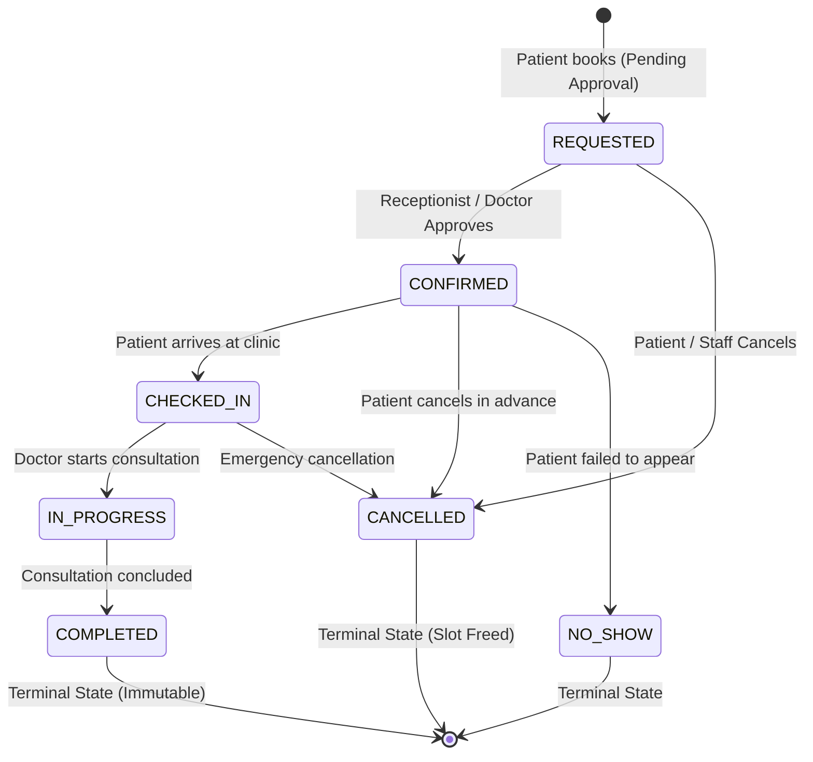
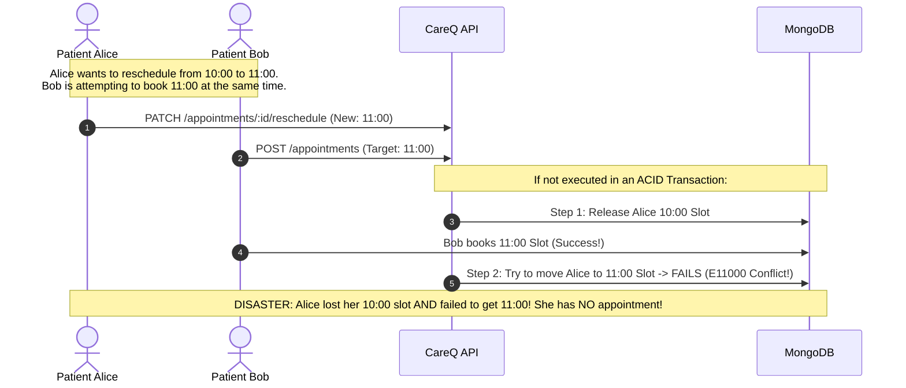
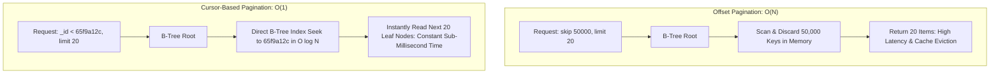

# CareQ Engineering Interview Mastery Guide
## Module 3: Appointment Management System

> **Target Roles:** Staff/Senior Backend Engineer, Systems Designer, API Platform Architect  
> **Core Topics:** Finite State Machines (FSM), Atomic Rescheduling, Slot Swapping, Cursor vs. Offset Pagination, REST API Design, Business Rule Invariants.

---

## Table of Contents
1. [Finite State Machines (FSM) & Lifecycle Architecture](#1-finite-state-machines-fsm--lifecycle-architecture)
   - Q1.1: Why Implement a State Machine Instead of Simple CRUD Status Updates?
   - Q1.2: Terminal States & Defending Against Illegal Transitions (e.g., `COMPLETED` $\rightarrow$ `CONFIRMED`)
   - Q1.3: Role-Based State Transition Matrix & Privilege Separation
2. [Atomic Rescheduling & Slot Release Mechanics](#2-atomic-rescheduling--slot-release-mechanics)
   - Q2.1: The Rescheduling Concurrency Hazard (The "Double-Slot Lock" Problem)
   - Q2.2: How MongoDB Transactions + Unique Indexes Guarantee Atomic Slot Swaps
   - Q2.3: Preserving Clinical Audit History in `rescheduleHistory`
3. [Cancellation Policies & Slot Recovery](#3-cancellation-policies--slot-recovery)
   - Q3.1: Soft Deletes vs. Status Flags vs. Partial Filter Index Exemption
   - Q3.2: Late Cancellation Business Rules & Preventing Past Slot Manipulation
4. [Pagination Architecture at Scale: Offset vs. Cursor](#4-pagination-architecture-at-scale-offset-vs-cursor)
   - Q4.1: Why `skip()` is an $O(N)$ Performance Anti-Pattern in MongoDB
   - Q4.2: The "Page Drift" Anomaly in High-Frequency Booking Feeds
   - Q4.3: Cursor-Based (Keyset) Pagination: $O(1)$ B-Tree Range Seeks
5. [REST API Design & Idempotency](#5-rest-api-design--idempotency)
   - Q5.1: `PATCH` vs. `PUT` vs. `POST` for State Transitions
   - Q5.2: Safe API Retries with Idempotency Keys During Rescheduling

---

## 1. Finite State Machines (FSM) & Lifecycle Architecture

### Q1.1: Why did you model appointment status as a Finite State Machine (FSM) rather than standard CRUD endpoints like `PUT /appointments/:id`?

#### What the Interviewer is Evaluating:
Domain Modeling maturity, defensive programming, and preventing illegal business states.

#### The Flawed Approach (CRUD / Naive Setter):
```typescript
// DANGEROUS: Arbitrary state assignment
app.put('/appointments/:id', async (req, res) => {
  const appointment = await Appointment.findByIdAndUpdate(
    req.params.id,
    { status: req.body.status },
    { new: true }
  );
  res.json(appointment);
});
```

#### Why Naive Updates Fail in Healthcare:
1. **Illegal State Teleportation:** A patient could set their status directly from `REQUESTED` to `COMPLETED` to fake an insurance claim.
2. **Zombie Appointments:** A user could revive a `CANCELLED` appointment back to `CONFIRMED`, ignoring whether the slot was already reassigned to someone else.
3. **Double Billing / Audit Violations:** A doctor could accidentally set a `COMPLETED` appointment back to `CHECKED_IN`, triggering duplicate billing workflows or messing up electronic health record (EHR) syncs.

#### The Senior Engineer's FSM Implementation:
In CareQ, an appointment can only progress along strictly defined directed graph edges:



```typescript
// Validated in src/services/appointment.service.ts
const allowedTargets = ALLOWED_STATUS_TRANSITIONS[currentStatus] || [];
if (!allowedTargets.includes(targetStatus)) {
  throw new Error(`Invalid state transition: Cannot change status from '${currentStatus}' to '${targetStatus}'.`);
}
```

---

### Q1.2: What is a Terminal State, and how does your architecture guarantee immutability once an appointment reaches `COMPLETED`?

#### The Ideal Answer:
A **Terminal State** is an absorbing state in a state machine from which no outgoing transitions exist:
$$\text{Transitions}(\text{COMPLETED}) = \emptyset$$
$$\text{Transitions}(\text{CANCELLED}) = \emptyset$$
$$\text{Transitions}(\text{NO\_SHOW}) = \emptyset$$

Once an appointment is marked `COMPLETED`, the medical encounter has concluded. Clinical notes, diagnoses, and prescriptions are signed off. 
- In `ALLOWED_STATUS_TRANSITIONS`, `COMPLETED` maps to an empty array `[]`.
- Any subsequent attempt to transition the appointment (even by an Admin) is rejected with `HTTP 400 Bad Request`.
- If an addendum is required later, it must be added as a separate `clinicalAddendum` document, preserving the immutability of the original encounter.

---

### Q1.3: How does your state machine enforce Role-Based Transition Permissions? Why can't a patient mark their own appointment `COMPLETED`?

#### The Ideal Answer:
Not all actors have equal authority over state transitions. CareQ enforces a **Transition Permission Matrix**:

| Target State | Permitted Roles | Business Rationale |
| :--- | :--- | :--- |
| `CONFIRMED` | `RECEPTIONIST`, `DOCTOR`, `ADMIN` | Staff confirms doctor availability and insurance eligibility. |
| `CHECKED_IN` | `RECEPTIONIST`, `ADMIN`, `PATIENT` | Receptionist marks arrival; patient can self-check-in at clinic kiosk. |
| `IN_PROGRESS` | `DOCTOR`, `ADMIN` | Only the attending clinician can start the consultation. |
| `COMPLETED` | `DOCTOR`, `ADMIN` | Only the clinician can officially close the medical encounter. |
| `CANCELLED` | `PATIENT`, `RECEPTIONIST`, `DOCTOR`, `ADMIN` | Any party can cancel prior to the appointment. |
| `NO_SHOW` | `RECEPTIONIST`, `DOCTOR`, `ADMIN` | Staff marks absence after the scheduled time window has passed. |

```typescript
// Enforced in src/services/appointment.service.ts
const permittedRoles = ROLE_TRANSITION_PERMISSIONS[targetStatus] || [];
if (!permittedRoles.includes(actor.role)) {
  throw new Error(`Forbidden: Role '${actor.role}' cannot transition appointment to '${targetStatus}'.`);
}
```

---

## 2. Atomic Rescheduling & Slot Release Mechanics

### Q2.1: Why is rescheduling an appointment significantly harder than booking a new one? What is the "Double-Slot Lock" race condition?

#### The Ideal Answer:
Rescheduling involves **two distinct time slots simultaneously**:
1. Releasing the **Current Slot** ($S_{\text{old}}$).
2. Claiming the **New Slot** ($S_{\text{new}}$).



#### The Failure Mode without Transactions:
If Step 1 releases the old slot before confirming the new slot, and Step 2 fails because another patient grabbed the new slot, the patient is left with an invalid state or loses both slots. Conversely, if Step 2 is attempted without releasing Step 1, the user temporarily holds two slots.

---

### Q2.2: How did you implement Atomic Rescheduling in CareQ using MongoDB Transactions?

#### The Ideal Answer:
We execute the slot transfer inside an **ACID Transaction with the Unique Partial Index**:

```typescript
// From src/services/appointment.service.ts
const session = await mongoose.startSession();
session.startTransaction();

try {
  // 1. Record old slot in audit history
  appointment.rescheduleHistory.push({
    previousSlotStartTime: appointment.slotStartTime,
    previousSlotEndTime: appointment.slotEndTime,
    rescheduledAt: new Date(),
    rescheduledBy: actor.id,
  });

  // 2. Modify to new slot
  appointment.slotStartTime = newStartTime;
  appointment.slotEndTime = newEndTime;

  // 3. Save inside transaction
  await appointment.save({ session });
  await session.commitTransaction();

  return appointment;
} catch (err: any) {
  if (session.inTransaction()) {
    await session.abortTransaction(); // Rollback: appointment retains old slot!
  }
  if (err.code === 11000) {
    throw new Error('Reschedule conflict: Target slot is already booked.');
  }
  throw err;
} finally {
  session.endSession();
}
```

#### Why This is Guaranteed Safe:
1. If another patient already claimed `newStartTime`, MongoDB's unique index throws `E11000`.
2. The transaction aborts (`abortTransaction`).
3. The appointment document remains in its original slot (`oldStartTime`) unchanged. Zero data loss.
4. If the new slot is free, the write commits:
   - The unique index key for `newStartTime` is inserted.
   - The unique index key for `oldStartTime` is updated/removed.
   - The old slot is immediately visible as `AVAILABLE` for any other patient to book!

---

### Q2.3: How does CareQ maintain audit compliance when an appointment is rescheduled multiple times?

#### The Ideal Answer:
Medical scheduling regulations require knowing who changed an appointment and when. Instead of overwriting timestamps, we use an embedded **Append-Only History Array**:
```typescript
rescheduleHistory: [
  {
    previousSlotStartTime: ISODate("2026-11-20T09:00:00Z"),
    previousSlotEndTime: ISODate("2026-11-20T09:20:00Z"),
    rescheduledAt: ISODate("2026-11-15T14:30:00Z"),
    rescheduledBy: ObjectId("65f1234a...")
  }
]
```
This guarantees complete traceability without requiring a separate audit collection for standard scheduling tracking.

---

## 3. Cancellation Policies & Slot Recovery

### Q3.1: How does CareQ handle appointment cancellation? Why not use HTTP `DELETE` to drop the document from MongoDB?

#### The Ideal Answer:
**Hard Deletes (`deleteOne` / `DELETE`) are strictly forbidden in healthcare systems.**

#### Three Critical Reasons:
1. **Medical & Regulatory Compliance:** Healthcare systems are legally mandated (e.g., HIPAA, NHS regulations) to retain records of all patient interactions, cancellations, and doctor availability history for 5–7 years.
2. **Billing & Cancellation Fees:** Clinics enforce cancellation fees (e.g., "50% charge if cancelled within 2 hours"). If the document is deleted, you lose the proof of booking and cancellation timestamps.
3. **Audit Trails & Analytics:** Clinics analyze patient no-show and cancellation rates to optimize overbooking algorithms.

#### The CareQ Pattern:
We update the document status to `CANCELLED` and record `cancelledAt`, `cancelledBy`, and `cancellationReason`. Because of our **Partial Filter Unique Index**, setting `status = 'CANCELLED'` automatically purges the document from the unique index, immediately freeing the slot in the public pool without losing the document!

---

### Q3.2: What business rules protect against "Late Cancellations"?

#### The Ideal Answer:
In `AppointmentService.transitionStatus()`:
```typescript
if (targetStatus === AppointmentStatus.CANCELLED && actor.role === UserRole.PATIENT) {
  // Disallow cancelling past appointments
  if (appointment.slotStartTime.getTime() <= Date.now()) {
    throw new Error('Cannot cancel an appointment that has already started or passed.');
  }

  // Clinic Late-Cancellation Rule (e.g. 2-hour minimum notice)
  const twoHoursMs = 2 * 60 * 60 * 1000;
  if (appointment.slotStartTime.getTime() - Date.now() < twoHoursMs) {
    // Flag as late cancellation or require receptionist assistance
    appointment.notes = '[LATE CANCELLATION: Subject to fee]';
  }
}
```

---

## 4. Pagination Architecture at Scale: Offset vs. Cursor

### Q4.1: Why is Offset Pagination (`skip` + `limit`) an $O(N)$ performance anti-pattern in MongoDB at high scale?

#### What the Interviewer is Evaluating:
Knowledge of database storage engine internals, index traversal, and scalability limits.

#### How Offset Pagination Works:
```typescript
Appointment.find().sort({ slotStartTime: -1 }).skip(50000).limit(20);
```

#### Why it Degrades at Scale:
To execute `skip(50000)`, MongoDB **cannot jump directly to document 50,001**.
The WiredTiger storage engine must:
1. Traverse the B-Tree index from the very beginning.
2. Scan and iterate through **50,000 index keys**.
3. Discard all 50,000 entries.
4. Return only the next 20 entries.

As `skip` increases:
- CPU utilization spikes.
- Query latency increases linearly from $1\text{ms}$ to $500\text{ms}+$.
- Database cache pages are unnecessarily loaded and evicted.

---

### Q4.2: What is the "Page Drift" (Duplicate/Skipped Items) problem in Offset Pagination?

#### The Problem Trace:
Suppose user Alice is browsing appointments sorted newest to oldest:
1. Alice requests Page 1 (`limit = 10, skip = 0`). She receives appointments 1 through 10.
2. While Alice is reading Page 1, **2 new appointments are booked** and inserted at the top of the collection.
3. Alice clicks "Page 2" (`limit = 10, skip = 10`).
4. The database skips the first 10 documents.
5. **The Glitch:** Because 2 new items were inserted at the top, the items that were previously at positions #9 and #10 have now shifted down to positions #11 and #12!
6. Alice sees the same two appointments again on Page 2!
7. If appointments were deleted instead, Alice would skip documents entirely.

---

### Q4.3: How does Cursor-Based (Keyset) Pagination solve both performance and drift problems?

#### The Keyset Solution:
Instead of skipping $N$ records, the client requests records relative to a **specific stable pointer (the Cursor)** — typically the unique, monotonically indexed `_id` or `slotStartTime`:

```typescript
// Query for Next Page
const filter = {
  doctorId: targetDoctor,
  _id: { $lt: new Types.ObjectId(cursor) } // Seek records created BEFORE this cursor
};

const items = await Appointment.find(filter)
  .sort({ _id: -1 })
  .limit(limit + 1);
```



| Dimension | Offset Pagination (`skip/limit`) | Cursor-Based Pagination (`cursor`) |
| :--- | :--- | :--- |
| **Time Complexity** | $O(N)$ where $N = \text{offset}$ | $O(1)$ relative to page depth ($O(\log K)$ B-Tree seek) |
| **Page Drift / Duplicates** | Vulnerable to insertions/deletions during scrolling | **Immune.** The cursor guarantees a fixed reference boundary. |
| **UI Compatibility** | Numbered page buttons (`[1] [2] [3]...`) | Infinite scroll / "Load More" feeds |
| **Memory Consumption** | High cache churn on deep pages | Minimal memory overhead |

#### CareQ Implementation:
In `AppointmentService.getAppointments()`, we support **both modes**:
- If `cursor` is provided, it runs the ultra-fast $O(1)$ Keyset pagination.
- If `page` and `limit` are provided, it runs standard offset pagination for legacy administrative data tables.

---

## 5. REST API Design & Idempotency

### Q5.1: Why did you use `PATCH` for state transitions and rescheduling instead of `POST` or `PUT`?

#### The Ideal Answer:
We adhere strictly to RFC 7231 and RFC 5789 HTTP semantic standards:
- **`PUT` (Complete Replacement):** Requires sending the entire modified entity representation. If you omit fields, they are wiped or replaced with null. Using `PUT /appointments/:id` just to change `status` violates REST semantics.
- **`PATCH` (Partial Modification):** Specifically designed to apply a delta/partial update to an existing resource.
  `PATCH /api/v1/appointments/:id/status` conveys that we are modifying only the state sub-field.
  `PATCH /api/v1/appointments/:id/reschedule` conveys that we are modifying the timing properties.
- **`POST`:** Reserved for non-idempotent resource creation (`POST /api/v1/appointments`).

---

### Q5.2: How do you guarantee that an appointment is not double-cancelled or double-rescheduled if an automated retry occurs?

#### The Ideal Answer:
1. **FSM State Invariants:**
   If a client sends `DELETE /appointments/123` twice:
   - First call: Status transitions `CONFIRMED` $\rightarrow$ `CANCELLED` (HTTP 200).
   - Second call: Current status is `CANCELLED`. In `ALLOWED_STATUS_TRANSITIONS`, `CANCELLED` has no valid transitions. The service rejects the second call with `HTTP 400: Invalid state transition`.
2. **Idempotency Keys for Mutations:**
   For state changes involving payments or SMS notifications, attaching an `idempotencyKey` ensures the backend returns the cached prior execution result without re-triggering side effects.

---

## Summary Checklist: Module 3 Senior Interview Talking Points

1. **Finite State Machine Rigor:** Eliminated arbitrary CRUD updates in favor of an explicit directed graph with terminal absorbing states (`COMPLETED`, `CANCELLED`, `NO_SHOW`).
2. **Atomic Slot Swapping:** Handled rescheduling as an atomic multi-document transaction protected by MongoDB unique partial indexes, preventing the "Double-Slot Lock" dilemma.
3. **Regulatory Audit Retention:** Maintained an embedded, append-only `rescheduleHistory` and replaced hard deletion with status updates that automatically release slots.
4. **Scalable Pagination Engineering:** Articulated the $O(N)$ memory/cache pitfalls of `skip()` and implemented $O(1)$ cursor-based keyset pagination alongside offset pagination.
