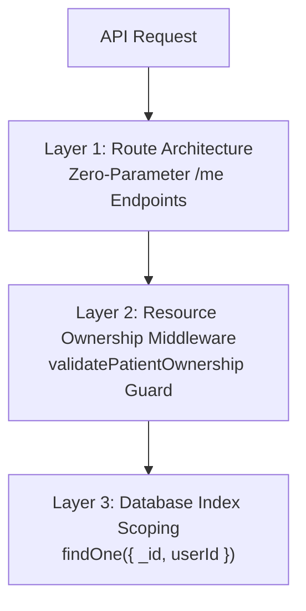

# CareQ Engineering Interview Mastery Guide
## Module 5: Healthcare API Security

> **Target Roles:** Staff/Senior Backend Engineer, Healthcare Security Architect, API Platform Engineer  
> **Core Topics:** OWASP API Security Top 10 (2023), HIPAA Compliance (§ 164.312), Tamper-Resistant Audit Logging, BOLA/BFLA Defenses, NoSQL Injection Mitigation, Synthetic Clinical Data.

---

## Table of Contents
1. [Healthcare Compliance & Regulatory Engineering](#1-healthcare-compliance--regulatory-engineering)
   - Q1.1: What Constitutes ePHI Under HIPAA, and What is the "Minimum Necessary Rule"?
   - Q1.2: Audit Logging Mandates (§ 164.312(b)): Why Read Access Must Be Logged
   - Q1.3: Synthetic Patient Data vs. Production Data: The Safe Harbor Method
2. [OWASP API Security Top 10 (2023 Edition) in Healthcare](#2-owasp-api-security-top-10-2023-edition-in-healthcare)
   - Q2.1: API1:2023 - Broken Object Level Authorization (BOLA / IDOR)
   - Q2.2: API2:2023 - Broken Authentication (Token Replay & Stale Sessions)
   - Q2.3: API3:2023 - Broken Object Property Level Authorization (Mass Assignment)
   - Q2.4: API4:2023 - Unrestricted Resource Consumption (Rate Limiting & DoS)
   - Q2.5: API5:2023 - Broken Function Level Authorization (BFLA)
3. [Injection & Defensive API Hardening](#3-injection--defensive-api-hardening)
   - Q3.1: NoSQL Operator Injection Mechanisms & Express 5 Mitigation
   - Q3.2: Information Leakage Prevention & Sanitized Error Contracts
   - Q3.3: HTTP Security Headers via Helmet (HSTS, CSP, Framing)
4. [Advanced Authorization: RBAC vs. ReBAC vs. ABAC](#4-advanced-authorization-rbac-vs-rebac-vs-abac)
   - Q4.1: Why Role-Based Access Control (RBAC) Fails in Clinical Workflows
   - Q4.2: Relationship-Based Access Control (ReBAC) for Doctor-Patient Encounters
   - Q4.3: Policy Engines: Implementing Open Policy Agent (OPA) / Cedar
5. [Cryptography & Session Invalidation at Scale](#5-cryptography--session-invalidation-at-scale)
   - Q5.1: Argon2id vs. Bcrypt: Resistance to GPU and ASIC Cracking
   - Q5.2: Invalidation of Stateless JWTs Without Centralized Redis Lookups

---

## 1. Healthcare Compliance & Regulatory Engineering

### Q1.1: What constitutes ePHI under HIPAA, and how does your API enforce the "Minimum Necessary Rule"?

#### What the Interviewer is Evaluating:
Comprehension of healthcare regulatory constraints, data classification, and least-privilege API design.

#### What is ePHI?
**electronic Protected Health Information (ePHI)** is any individually identifiable health information transmitted or maintained in electronic media:
- Demographic data (Name, address, DOB, phone, SSN).
- Medical history, diagnoses, lab results, prescriptions.
- Billing, insurance, and clinical scheduling records.

#### The "Minimum Necessary Rule" (HIPAA § 164.502(b)):
A covered entity must make reasonable efforts to limit protected health information to the **minimum necessary to accomplish the intended purpose of the use, disclosure, or request**.

#### How CareQ Enforces It:
1. **Clinical Staff Isolation:** Receptionists booking an appointment can view patient demographics (`name`, `phone`, `insuranceStatus`), but clinical fields (`medicalNotes`, `allergies`, `diagnosis`) are excluded from their query projections.
2. **Decoupled User Identity:** The `User` authentication collection contains zero medical information. An auth compromise does not expose patient health records.
3. **Role-Based Projections:** We use Mongoose projection pruning to omit sensitive fields based on the caller's role:
   ```typescript
   if (req.user.role === UserRole.RECEPTIONIST) {
     query.select('-medicalNotes -allergies -bloodGroup');
   }
   ```

---

### Q1.2: Why does HIPAA mandate logging READ operations (§ 164.312(b)), and how did you implement tamper-resistant audit trails?

#### The Ideal Answer:
In standard SaaS applications, engineers typically log only write/mutation operations (`POST`, `PUT`, `DELETE`). 

**In healthcare, logging READ operations is legally mandatory.**
If an unauthorized nurse or doctor views a celebrity patient's medical records without a clinical reason (a famous violation known as "snooping"), the hospital must be able to prove:
- **Who** viewed the record (`userId`, `userRole`, `userEmail`).
- **Which** patient's file was accessed (`patientId`).
- **When** the access occurred (`createdAt` timestamp).
- **From where** (`ipAddress`, `userAgent`).

#### The CareQ Implementation (`src/middlewares/audit.ts`):
```typescript
res.on('finish', async () => {
  await AuditLog.create({
    userId: req.user?.id,
    userRole: req.user?.role,
    userEmail: req.user?.email,
    action: isSuccess ? AuditAction.READ : AuditAction.ACCESS_DENIED,
    resource: 'PATIENT_RECORD',
    patientId: targetPatientId,
    ipAddress: req.ip,
    status: isSuccess ? 'SUCCESS' : 'FAILURE',
  });
});
```

#### Tamper-Resistance & Audit Storage:
1. **Append-Only Immutability:** In `AuditLogSchema`, we disable updates: `{ timestamps: { createdAt: true, updatedAt: false } }`. No API endpoint permits modifying or deleting audit entries.
2. **Asynchronous Execution (`res.on('finish')`):** Audit logging runs asynchronously after the response stream completes, ensuring compliance logging does not add latency to patient response times.
3. **Enterprise Production Pattern:** In production, audit logs are streamed to append-only WORM (Write Once, Read Many) storage or cloud audit vaults (e.g., AWS CloudWatch Logs with S3 Object Lock or Datadog Audit Trail) where even database superadmins cannot alter history.

---

### Q1.3: Why is using real production patient data in staging/development environments a critical compliance violation? How does synthetic data solve this?

#### The Ideal Answer:
Under HIPAA (§ 164.514), using real patient data in non-production environments (development, CI/CD, staging, QA) violates federal law unless the data is completely de-identified. Developers, QA engineers, and contractors often lack HIPAA clearance. Furthermore, developer laptops and staging databases lack production-grade encryption, physical security, and SOC-2 access controls.

#### The CareQ Solution: Deterministic Synthetic Factories
We built `SyntheticDataFactory` (`src/utils/synthetic-data.ts`) to programmatically generate realistic clinical records:
- Fake names, randomized birth dates, dummy medical record numbers.
- Randomized non-PII email domains (`@careq-test.internal`).
- Valid clinical attributes (ICD-10 diagnostic codes, blood types, standard allergies).
- Zero risk of patient privacy exposure during automated stress tests and CI/CD pipelines.

---

## 2. OWASP API Security Top 10 (2023 Edition) in Healthcare

### Q2.1: Walk me through how CareQ defends against OWASP API1:2023 - Broken Object Level Authorization (BOLA / IDOR).

#### What the Interviewer is Evaluating:
Your depth on the #1 API security vulnerability in the world.

#### The Multi-Layered Defense in CareQ:



1. **Layer 1: The Zero-Parameter `/me` Pattern:**
   For mobile apps and patient portals, endpoints like `GET /api/v1/patients/me` never accept an ID from the client. The patient identity is derived strictly from `req.user.id` inside the cryptographically verified JWT.
2. **Layer 2: Resource-Level Ownership Middleware (`validatePatientOwnership`):**
   When parameterized routes like `GET /api/v1/patients/:id` are called:
   - If caller is `PATIENT`: Verify `patient.userId.toString() === req.user.id`. If mismatched, reject with `403 Forbidden` (or `404 Not Found`).
   - If caller is `DOCTOR`: Enforce clinical relationship verification (ReBAC).
3. **Layer 3: Scoped Database Queries:**
   Queries never search solely by entity ID. They scope by user boundary:
   ```typescript
   const appointment = await Appointment.findOne({ _id: req.params.id, patientId: userPatientId });
   ```

---

### Q2.2: How does CareQ mitigate OWASP API2:2023 - Broken Authentication?

#### The Ideal Answer:
1. **Short-Lived Access Tokens (15 min):** Minimizes the exposure window if a bearer token is intercepted.
2. **Refresh Token Rotation (RTR):** Every token refresh consumes the old refresh token and issues a new pair.
3. **Token Reuse Detection (Replay Defense):** We store SHA-256 hashes of valid refresh tokens. If an attacker uses a previously rotated token, the server detects the token is not in the active session list and **instantly revokes all active sessions for that user across all devices**.
4. **Immediate Password Change Invalidation:** The `passwordChangedAt` timestamp invalidates all previously issued JWTs immediately upon a credential reset.

---

### Q2.3: Explain OWASP API3:2023 - Broken Object Property Level Authorization (Mass Assignment) and how your Zod schemas prevent it.

#### The Attack Vector:
A patient sends `POST /api/v1/auth/register/patient` with an unexpected administrative payload:
```json
{
  "email": "attacker@evil.com",
  "password": "Password123!",
  "role": "ADMIN",
  "isActive": true
}
```
If the backend does `await User.create(req.body)`, the attacker becomes an **`ADMIN`**.

#### The CareQ Defense:
1. **Strict Zod Runtime Validation:**
   In `registerPatientSchema`, the field `role` is **intentionally omitted**. Zod strips unknown fields or rejects payloads with unregistered keys:
   ```typescript
   export const registerPatientSchema = z.object({
     email: z.string().email(),
     password: z.string().min(8),
     firstName: z.string(),
     lastName: z.string(),
     // Notice: role is omitted!
   });
   ```
2. **Controller-Level Role Assignment:**
   In `AuthController.registerPatient()`, the role is hardcoded by the application logic:
   ```typescript
   const user = new User({ email, password, role: UserRole.PATIENT });
   ```
   As verified in our live test (`scripts/test-module5.ts`), injecting `role: "ADMIN"` resulted in `UserRole.PATIENT` in the database.

---

### Q2.4: How does CareQ mitigate OWASP API4:2023 - Unrestricted Resource Consumption?

#### The Ideal Answer:
1. **Payload Size Bounds:**
   `app.use(express.json({ limit: '10kb' }))` prevents attackers from crashing the Node.js event loop by sending 100MB JSON payloads.
2. **Rate Limiting:**
   `express-rate-limit` throttles auth endpoints to a maximum of 100 requests per 15 minutes per IP address to stop credential stuffing.
3. **Query Pagination Caps:**
   `getAppointments()` enforces a hard maximum `limit = Math.min(100, req.query.limit)` to prevent attackers from executing unpaginated memory-exhaustion queries (`limit=1000000`).

---

### Q2.5: What is OWASP API5:2023 - Broken Function Level Authorization (BFLA), and how does CareQ enforce it?

#### The Attack Vector:
A patient discovers an administrative or doctor-only endpoint like `POST /api/v1/doctors/:doctorId/availability` or `PATCH /api/v1/appointments/:id/status` (marking an appointment `COMPLETED`).

#### The CareQ Defense:
1. **Coarse-Grained RBAC Middleware (`authorize(...)`):**
   ```typescript
   router.post('/availability', authenticate, authorize(UserRole.DOCTOR, UserRole.ADMIN), ...);
   ```
2. **State Machine Transition Permissions (`ROLE_TRANSITION_PERMISSIONS`):**
   Even if a user bypasses URL filters, `AppointmentService.transitionStatus()` validates whether the caller's role is permitted to trigger that specific state transition.

---

## 3. Injection & Defensive API Hardening

### Q3.1: How does NoSQL injection occur in MongoDB, and how did your deep key sanitizer eliminate it in Express 5?

#### The NoSQL Operator Injection Attack:
If an attacker sends JSON:
```json
{
  "email": { "$ne": null },
  "password": { "$ne": null }
}
```
MongoDB's `$ne` operator matches all documents where `email` and `password` are not null, bypassing authentication.

#### Why `express-mongo-sanitize` Broke in Express 5:
`express-mongo-sanitize` attempts to reassign `req.query = sanitize(req.query)`.
In **Express 5**, `req.query` is defined as a **getter-only property** on the HTTP `IncomingMessage` prototype. Reassignment throws:
`TypeError: Cannot set property query of #<IncomingMessage> which has only a getter`.

#### The CareQ In-Place Deep Sanitizer:
We built an in-place object mutator that recursively strips any object key starting with `$` or containing `.`:
```typescript
const sanitize = (obj: any): any => {
  if (!obj || typeof obj !== 'object') return obj;
  for (const key of Object.keys(obj)) {
    if (key.startsWith('$') || key.includes('.')) {
      delete obj[key];
    } else if (typeof obj[key] === 'object') {
      sanitize(obj[key]);
    }
  }
  return obj;
};
```
As verified in `test-module5.ts`, submitting `{ email: { $ne: null } }` causes the key to be deleted, and Zod immediately rejects the payload with `HTTP 400 Validation failed`.

---

### Q3.2: Why must production APIs never return raw error messages or stack traces? How does CareQ sanitize error responses?

#### The Risk of Information Leakage:
Returning raw error details leaks:
- Database software version and driver internals (`MongoServerError: index appointments.doctorId_1...`).
- Internal server file paths (`C:\Users\Mohit\Desktop\CareQ\src\controllers\...`).
- Schema property names and credentials.

#### The CareQ Global Error Handler:
```typescript
app.use((err: any, req: Request, res: Response, next: NextFunction) => {
  const status = err.status || err.statusCode || 500;
  const isProd = process.env.NODE_ENV === 'production';

  const responseMessage =
    status >= 500 && isProd
      ? 'An unexpected error occurred on the server. Please contact support.'
      : err.message || 'Internal server error';

  res.status(status).json({ success: false, status, message: responseMessage });
});
```

---

## 4. Advanced Authorization: RBAC vs. ReBAC vs. ABAC

### Q4.1: Why is Role-Based Access Control (RBAC) insufficient for healthcare APIs?

#### The Architectural Comparison:

| Access Control Model | How it Works | Clinical Limitation |
| :--- | :--- | :--- |
| **RBAC (Role-Based)** | Grants permissions based on job title: `PATIENT`, `DOCTOR`, `NURSE`. | **Coarse-grained.** A doctor with `DOCTOR` role could view medical files for patients they are not treating! |
| **ReBAC (Relationship-Based)** | Evaluates relationships between entities: `Doctor treats Patient`. | **Ideal for Clinical Care.** Access is granted only if an active appointment, referral, or assigned care team relationship exists. |
| **ABAC (Attribute-Based)** | Evaluates dynamic attributes: `Time`, `Location`, `Department`, `Emergency Override`. | **Ideal for Emergency Medicine.** Allows a physician in the ER to access any record during an emergency ("Break-the-Glass" access), but alerts compliance officers. |

#### How CareQ Implements ReBAC:
A doctor's access to patient records is conditional on an active clinical encounter:
```typescript
const hasEncounter = await Appointment.exists({
  doctorId: req.user.doctorId,
  patientId: requestedPatientId,
  status: { $in: ['CONFIRMED', 'CHECKED_IN', 'IN_PROGRESS', 'COMPLETED'] },
});
if (!hasEncounter) {
  throw new Error('Forbidden: No active clinical relationship with this patient.');
}
```

---

## 5. Cryptography & Session Invalidation at Scale

### Q5.1: Why is Argon2id superior to standard Bcrypt for healthcare password hashing?

#### The Ideal Answer:
- **Bcrypt (Blowfish-based):** Compute-intensive (CPU-bound). While effective against CPU brute-forcing, modern attackers use GPU arrays (e.g., 8x NVIDIA RTX 4090s) and custom ASICs that can compute millions of Bcrypt hashes per second because Bcrypt uses minimal RAM.
- **Argon2id (Memory-Hard):** Winner of the Password Hashing Competition. Argon2id requires a configurable amount of **system memory (RAM)** (e.g., 64MB per hash) in addition to CPU time.
- **Why Memory-Hardness Matters:** GPUs have limited fast on-chip memory per core. Forcing an attacker's GPU to allocate 64MB of RAM per hash destroys the GPU's parallelism, making offline brute-forcing economically and computationally infeasible.

---

### Q5.2: How do you revoke stateless JWTs upon password change without querying a centralized Redis cache on every single API request?

#### The Ideal Answer:
This is the **Cryptographic Timestamp Invalidation Pattern (`passwordChangedAt`)**:

1. In `UserSchema`, we store `passwordChangedAt: Date`.
2. Whenever a user changes their password, `passwordChangedAt` is updated to the current time.
3. Every JWT contains the standard claim `iat` (issued at in epoch seconds).
4. In our `authenticate` middleware, after verifying the cryptographic HMAC signature:
   ```typescript
   if (user.passwordChangedAt) {
     const changedTimestamp = Math.floor(user.passwordChangedAt.getTime() / 1000);
     if (decoded.iat < changedTimestamp) {
       return res.status(401).json({ message: 'Token invalidated by password reset. Please login again.' });
     }
   }
   ```
5. Any token issued *prior* to the password change is rejected instantly, without requiring a centralized Redis token blacklist!

---

## Summary Checklist: Module 5 Senior Interview Talking Points

1. **HIPAA Audit Trail Compliance:** Implemented an asynchronous, append-only `AuditLog` collection capturing user identity, IP address, action, and target patient ID for every clinical access.
2. **OWASP API Security Top 10 Coverage:** Addressed BOLA (ownership guards & scoped queries), Broken Auth (RTR & replay detection), and Mass Assignment (Zod runtime stripping).
3. **Resilient Injection Sanitization:** Built an Express 5 compatible deep object key sanitizer neutralizing NoSQL operator injection (`$ne`, `$gt`).
4. **Relationship-Based Access Control (ReBAC):** Restated the HIPAA "Minimum Necessary Rule," ensuring clinicians can only view records for patients under their active care.
5. **Zero-PII Synthetic Factories:** Established automated synthetic patient generation to ensure developer environments and CI/CD pipelines never expose real patient health data.
